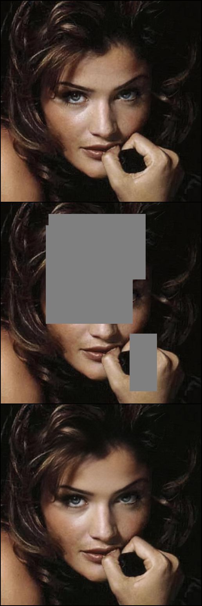
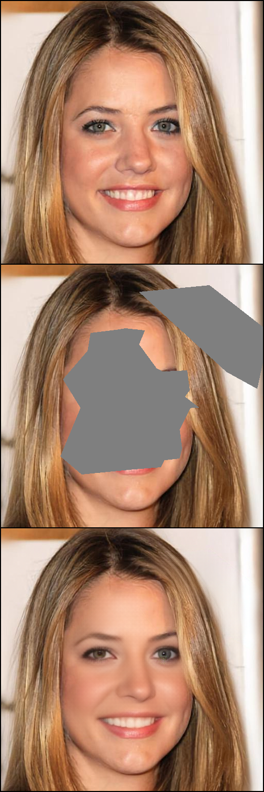
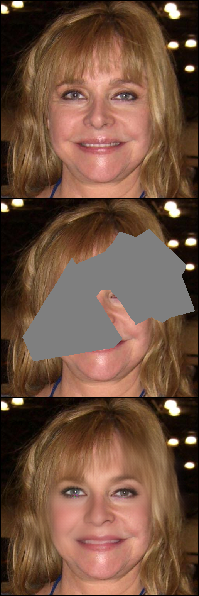
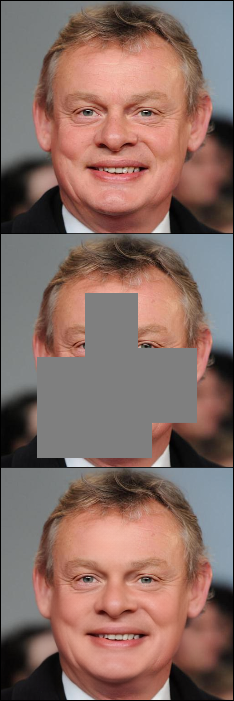
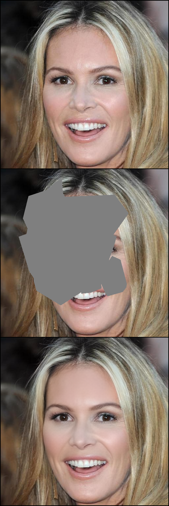
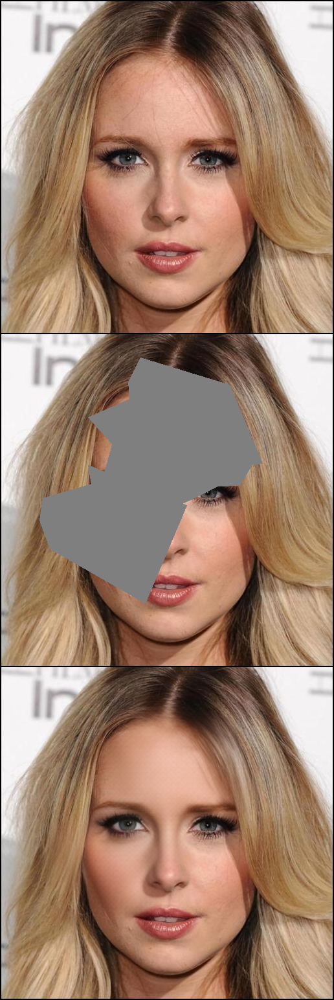
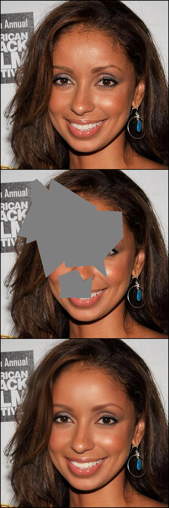
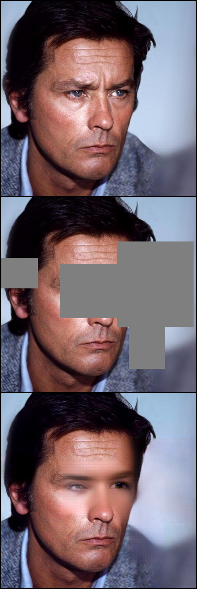
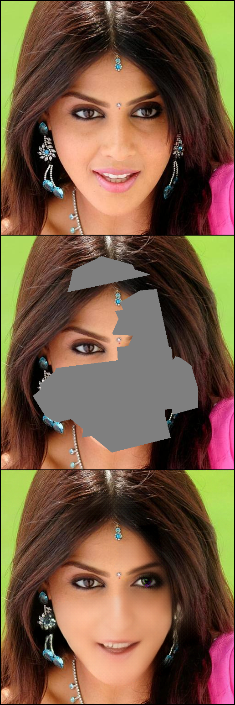
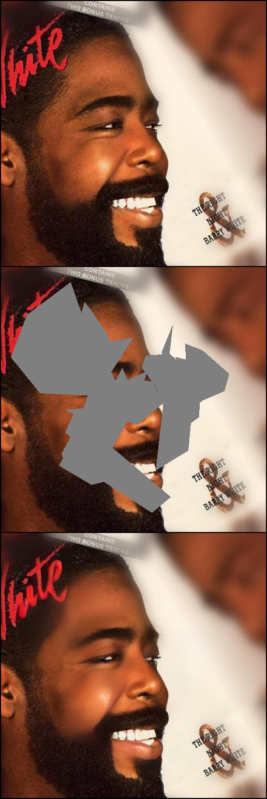

# SCADO-Diffusion: Structure-Conditioned Asymmetric Disjoint Attention for Face Inpainting

  <b>A facial inpainting framework combining Denoising Diffusion Probabilistic Models (DDPM) with Structure-Conditioned Asymmetric Disjoint Attention (SCADO) and dynamic Graph Attention landmark guidance.</b>

---

---

##  Qualitative Results & Progression

  Each image displays the evaluation triplet generated directly during training:
   
  <b>[ Top: Ground Truth ] &nbsp;•&nbsp; [ Middle: Masked Input ] &nbsp;•&nbsp; [ Bottom: SCADO Inpainting Result ]</b>

### Converged Inpainting Benchmarks (Steps 325,000 – 327,300)

| Sample 1 (Step 327.3k) | Sample 2 (Step 327.1k) | Sample 3 (Step 326.9k) | Sample 4 (Step 326.7k) | Sample 5 (Step 326.5k) |
| :---: | :---: | :---: | :---: | :---: |
|  |  |  |  |  |
| <b>Top:</b> Ground Truth <b>Mid:</b> Masked <b> Our Model:</b> SCADO Reconst. | <b>Top:</b> Ground Truth <b>Mid:</b> Masked <b> Our Model:</b> SCADO Reconst. | <b>Top:</b> Ground Truth <b>Mid:</b> Masked <b> Our Model:</b> SCADO Reconst. | <b>Top:</b> Ground Truth <b>Mid:</b> Masked <b> Our Model:</b> SCADO Reconst. | <b>Top:</b> Ground Truth <b>Mid:</b> Masked <b> Our Model:</b> SCADO Reconst. |

 

| Sample 6 (Step 326.3k) | Sample 7 (Step 326.0k) | Sample 8 (Step 325.7k) | Sample 9 (Step 325.5k) | Sample 10 (Step 325.0k) |
| :---: | :---: | :---: | :---: | :---: |
|  |  |  |  |  |
| <b>Top:</b> Ground Truth <b>Mid:</b> Masked <b>Our Model:</b> SCADO Reconst. | <b>Top:</b> Ground Truth <b>Mid:</b> Masked <b>Our Model:</b> SCADO Reconst. | <b>Top:</b> Ground Truth <b>Mid:</b> Masked <b>Our Model:</b> SCADO Reconst. | <b>Top:</b> Ground Truth <b>Mid:</b> Masked <b>Our Model:</b> SCADO Reconst. | <b>Top:</b> Ground Truth <b>Mid:</b> Masked <b> Our Model:</b> SCADO Reconst. |

 

---

### Architectural Mechanics:

1. **Disjoint Spatial Partitioning:**

   Spatial feature maps  are divided into corrupted positions  and uncorrupted visible tokens .

2. **Asymmetric Disjoint Cross-Attention:**

   - **Queries ():** Projected solely from corrupted regions :
     
     

   - **Keys & Values ():** Extracted purely from uncorrupted visible regions :
     
     

3. **Graph Attention Network (GAT) Landmark Prior:**

   Seven key facial landmarks generate 2D Gaussian heatmaps , dynamically weighted by a Graph Attention Network (), producing a structured spatial cross-attention bias:

   

     
   

4. **Bilateral Facial Symmetry Constraint:**

   A self-supervised symmetry loss directly penalizes horizontal asymmetry in the SCADO attention map:

   

     
   

---

## Multi-Objective Loss Formulation

The complete training objective combines generative diffusion, structural constraints, and perceptual realism:

  

Where:

- **Reconstruction Loss ():** Composite error consisting of DDPM noise prediction MSE and image-space L1 loss:
  

    
  

- **Symmetry Loss ():** Direct horizontal mirror penalty computed over SCADO cross-attention weights.
- **Perceptual Loss ():** Multi-scale feature matching loss across frozen VGG-16 layers (`relu1_2`, `relu2_2`, `relu3_3`, `relu4_3`).
- **Adversarial Loss ():** Hinge adversarial loss via a multi-scale PatchGAN discriminator enforcing high-frequency edge sharpness.
